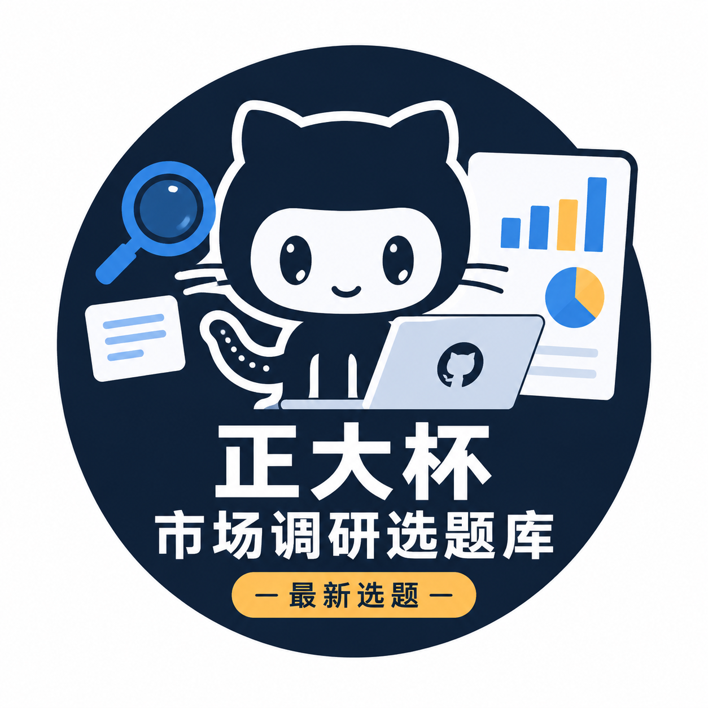
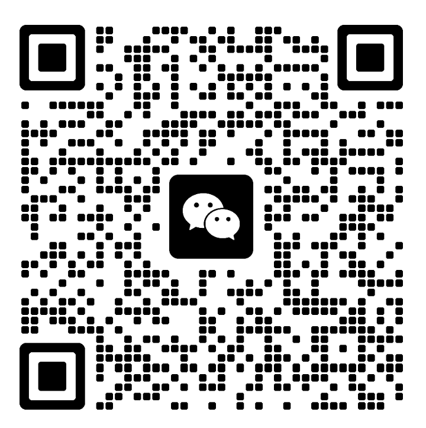

<p align="center">
  
</p>

<h1 align="center">📚 正大杯 · 2000题选题库（按行业分类）</h1>

<p align="center"><b>全国大学生市场调查与分析大赛 · 2000 个高质量选题 · 持续更新 · 全网最全正大杯选题库之一</b></p>

<p align="center">
  
  
  
  
</p>

<p align="center">
  
  
  
  
</p>

---

> **作者：呆塔大师兄（微信：a237658765）**
> 面向 **全国大学生市场调查与分析大赛（正大杯）** 的高质量选题合集，按行业归入 21 个目录，编号 001–2000 全库连续（基础 500 题 + 特色亮点 20 题 + 千题扩容 480 题 + 2026最新批次 400 题）。

## 📌 关于本仓库

> **这是什么？** 一个持续维护的正大杯（市场调查与分析大赛）选题资料库：**2000 个按行业分类的选题**，每个选题都有完整档案（研究对象、核心变量、研究阶段、可行性、参考来源）与 docx/pdf/水印版三件套文档，还随库附上 **2017–2026 近十年的官方获奖名单、赛制资料、计分评审说明、企业命题清单、AI 工具使用规范** 等备赛干货。

> **为什么值得关注？** 本仓库**长期保持更新**：
> - **📈 选题会持续扩充** — 每出现新热点、新政策、新消费现象即新增选题，数量只增不减；
> - **🧹 过气/撞车选题会持续替换** — 每次更新都对照最新官方获奖名单逐题避重核验，保证选题新颖、研究点不重复；
> - **📄 最新资料会持续分享** — 官方通知、获奖名单、评分细则等第一手备赛资料会随赛季推进第一时间同步到 `references/` 目录；
> - **💬 交流学习群** — 文末附微信交流学习群二维码，扫码入群和全国参赛同学互相答疑、共享资料；
> - **🎯 竞赛指导** — 呆塔大师兄提供正大杯一对一竞赛指导（选题把关、报告打磨、答辩辅导），微信 a237658765，带赛经验丰富，助你冲击国奖；
> - **✔️ 可放心 Star & Watch** — 关注本仓库即可在每次更新时收到通知，参赛资料不迷路。

| 📦 项目 | 📊 数值 |
|---|---:|
| 选题总数 | **2000**（基础 500 + 特色亮点 20 + 扩容 480 + 2026最新批次 400） |
| 行业分类 | **21** |
| 选题目录（含 docx/pdf/水印 三件套） | **2000** |
| 获奖黑名单（近三年国奖检索） | **9555 条** |
| 文档文件总数 | **≈4,200+** |
| 维护状态 | 🔄 持续更新 |

> 🏆 **获奖避重已启用**：全库 2000 题已逐题对照近三年（第14–16届）国一/国二/国三获奖名单（含研究生组、专科组、留学生组，共 9555 条标题）做重复性核验，发现撞车即替换，确保**研究对象可相近、研究点不重复**。

---

## 🧭 行业目录总览

| # | 行业目录 | 选题数 | # | 行业目录 | 选题数 |
|---:|---|---:|---:|---|---:|
| 01 | [01_银发经济](<01_银发经济>) | 151 | 12 | [12_教育与培训](<12_教育与培训>) | 111 |
| 02 | [02_宠物经济](<02_宠物经济>) | 72 | 13 | [13_职场与新就业](<13_职场与新就业>) | 91 |
| 03 | [03_人工智能与数字科技](<03_人工智能与数字科技>) | 126 | 14 | [14_乡村振兴与县域经济](<14_乡村振兴与县域经济>) | 101 |
| 04 | [04_文化旅游与演艺](<04_文化旅游与演艺>) | 189 | 15 | [15_绿色低碳与循环经济](<15_绿色低碳与循环经济>) | 53 |
| 05 | [05_体育健身与户外运动](<05_体育健身与户外运动>) | 99 | 16 | [16_二次元与青年潮流](<16_二次元与青年潮流>) | 109 |
| 06 | [06_餐饮食品](<06_餐饮食品>) | 106 | 17 | [17_美妆服饰与珠宝](<17_美妆服饰与珠宝>) | 59 |
| 07 | [07_零售商业与消费新形态](<07_零售商业与消费新形态>) | 116 | 18 | [18_母婴育儿与家庭](<18_母婴育儿与家庭>) | 66 |
| 08 | [08_居住与城市更新](<08_居住与城市更新>) | 89 | 19 | [19_婚恋与社交](<19_婚恋与社交>) | 47 |
| 09 | [09_汽车与出行](<09_汽车与出行>) | 83 | 20 | [20_传媒娱乐与数字内容](<20_传媒娱乐与数字内容>) | 41 |
| 10 | [10_金融保险与理财](<10_金融保险与理财>) | 81 | 21 | [21_公共治理与社会关怀](<21_公共治理与社会关怀>) | 77 |
| 11 | [11_健康医疗](<11_健康医疗>) | 133 | | **合计** | **2000** |

> 各行业目录内均有独立 `README.md`（徽章+选题清单）+ 全部选题目录。

---

## ✨ 扩容亮点（编号 501–2000）

> 2026-10 扩容批次：在基础 500 题之上新增 **880 题**（特色亮点 20 + 千题扩容 480 + 2026最新批次 400），逐题对照获奖黑名单避重，切口全部踩中 2025–2026 最新热点。

| 编号段 | 主题方向 | 代表选题 |
|---|---|---|
| 521–530 | 银发生活数字化 | 银发列车、长者食堂刷脸、智能药盒、银发跑者、视频团圆 |
| 531–540 | 宠物与情感消费 | 寻宠侦探、宠物度假酒店、宠物情绪课、宠物推车、分手宠物归属 |
| 541–560 | AI 与健康轻消费 | AI跑步教练、AI口语/绘本/冥想、老照片修复、AI装修、茶园研学、工业遗产酒店、赶海、古城夜宿、预制菜出海、小吃街数字化 |
| 561–580 | 消费新形态 | 极简生活、零食量贩、剧本杀倒闭潮、无包装购物、临期折扣店、二手奢侈品、阳台种菜、口袋公园、家电以旧换新、错峰充电V2G |
| 581–600 | 金融健康与教育 | 数币红包、惠民保、攒钱搭子、少儿财商、攒金豆、近视防控、成人疫苗、基因检测、AI志愿填报、村BA村超 |
| 601–620 | 避重全新切口 | 中老年骑行、仓储会员店、匹克球进社区、征信修复骗局、谷子改娃、AI批改作业、大模型降价潮、两轮换电站 |
| 621–700 | 城市与县域消费 | 犬类治理、慢行系统、助浴车、儿童安全座椅、押金监管、医美分期、买手店、带薪休假、目的地婚礼、马拉松参赛 |
| 701–800 | 民生与业态升级 | 城市漫步导览、陪诊师、社区食堂半成品、AI简历、村咖打卡、少儿编程、飞盘社群、国债抢购、博物馆夜场 |
| 801–900 | 热点新观察 | 即时送药、非遗手作课、深夜食堂、AI面试、中药代茶饮、蒙氏早教、直播切片、银发园艺、广场舞经济、临期特卖 |
| 901–1000 | 收官千题 | AI换脸治理、中医夜市、适老电梯、OK镜、彩票自助、女性玩家、编程进中考、午休改革、培育钻石、村超经济圈、微度假 |
| 1001–1100 | 2026最新·AI与银发健康 | 提示词工程师、数据标注师、脑机接口、商业航天、首发经济、好房子标准、超充网络、Cos委托、月球养老、干眼症门诊 |
| 1101–1200 | 2026最新·消费与县域 | 硬折扣超市、无人零售柜、云认养、强村公司、农事节庆、板式网球、屋顶经济、反内卷、WLB、月子餐 |
| 1201–1300 | 2026最新·文娱与潮流 | 竖店经济、华流出海、Livehouse、谷子店倒闭潮、痛文化、国漫出海、新中式妆造、演唱会戒断反应 |
| 1301–2000 | 2026最新·民生与治理 | 家庭养老床位、慢病长处方、医保比价、骑手公积金、大额存单、隐私面单、小小讲解员、记忆咖啡馆 |

---


## ✨ 新增选题（编号 1401–2000）

本批新增 600 个选题，按原有 21 个行业目录归类；每题提供 `_topic.txt`、Word、PDF 和水印版 PDF，并按双研究点公式整理。由于本轮联网检索接口不可用，新增题目的 2025–2026 趋势依据均标注为“待核验”，正式参赛前请补充官方与论文来源。

## 📁 目录结构

```text
按行业分类/
├── README.md                  # 本索引（您正在看）
├── _industry_map.json         # 编号→行业 映射表（机器可读）
├── 01_银发经济/               # 106 题
├── 02_宠物经济/               # 51 题
├── 03_人工智能与数字科技/     # 88 题
├── 04_文化旅游与演艺/         # 132 题
├── 05_体育健身与户外运动/     # 69 题
├── 06_餐饮食品/               # 74 题
├── 07_零售商业与消费新形态/   # 81 题
├── 08_居住与城市更新/         # 62 题
├── 09_汽车与出行/             # 58 题
├── 10_金融保险与理财/         # 57 题
├── 11_健康医疗/               # 93 题
├── 12_教育与培训/             # 78 题
├── 13_职场与新就业/           # 64 题
├── 14_乡村振兴与县域经济/     # 71 题
├── 15_绿色低碳与循环经济/     # 37 题
├── 16_二次元与青年潮流/       # 76 题
├── 17_美妆服饰与珠宝/         # 41 题
├── 18_母婴育儿与家庭/         # 46 题
├── 19_婚恋与社交/             # 33 题
├── 20_传媒娱乐与数字内容/     # 29 题
└── 21_公共治理与社会关怀/     # 54 题

# 单个选题目录（示例）
01_银发经济/
└── 089_“银发邮轮，海上慢游”.../
    ├── 选题说明.docx          # Word 选题档案
    ├── 选题说明.pdf           # PDF 版
    └── 选题说明_水印版.pdf    # 加水印 PDF（呆塔大师兄 · 微信 a237658765）
```

---

## 🎯 选题内容规范（双研究点公式版）

每个选题档案（`选题说明.docx`）按「一个题目一般含两个研究点」的选题公式输出契约生成，包含完整字段：

| 要素 | 说明 |
|---|---|
| **项目类型** | 市场调查 / 社会调查 |
| **研究阶段** | early（早期：需求与机会挖掘）/ mid（中期：消费意愿及影响因素）/ mature（成熟期：满意度与优化） |
| **建议地区** | 可落地的城市/县域/全国抽样框提示 |
| **确定行业** | 行业归口与选择理由（趋势证据 + 学术可行性 + 需求匹配） |
| **生成假设** | 待验证的研究假设（H1/H2，供问卷题项与数据分析锚定） |
| **研究对象** | 谁（人群/主体） |
| **核心问题/变量** | 研究什么（动机/意愿/满意度/行为等可测量变量） |
| **选题依据** | 参考来源 + 信息时间范围（2025–2026），证据分级 | 
| **可行性提示** | 数据渠道、抽样框与调研路径（含获奖避重核对说明） |

> 📌 证据分级：**✅** = 官方政策/权威媒体，可直接引用；**🔶** = 行业报告/媒体线索，参赛前必须下载原文核对，保证数据真实可溯、不虚构。近三年获奖黑名单（9555 条）已逐题避重核验。

> 🧬 **每个选题均按「一个题目一般含两个研究点」的选题公式规范化**：检索先行、行业定向、题目落点可操作（可转问卷/访谈/二手数据），结构统一为「选题定位 → 生成假设 → 选题依据 → 可行性提示 → 参考来源」五段式。

---

## 🔄 更新机制（核心）

> 本选题库**持续追踪最新信息**，随政策、市场与热点变化**定期更新**：

1. **🌐 持续追踪最新信息** — 每轮选题研发联网检索最新政策文件、权威媒体与行业报告（国家统计局、商务部、发改委、文旅部、教育部等官方来源 + 权威行业白皮书），保证选题锚点使用最新数据。
2. **🏆 获奖避重门禁** — 全库选题逐题对照近三年获奖名单（2024第十四届–2026第十六届，国一/国二/国三，含研究生/专科/留学生组）黑名单核验，研究对象可以接近，**研究点必须不重复**。
3. **➕ 持续补充新选题** — 新热点出现即新增选题。2026 年已累计新增：仅退款新政、演出强实名、AI 编程助手、银发助浴车、匹克球、大模型降价潮、错峰充电、无糖茶饮、陪诊师、AI面试、中医夜市、培育钻石等。
4. **🧹 定期清理与替换** — 对过气热点、老套题材、库内重复/撞奖选题，一律删除或替换为更新切口，保持全库 2000 题"无重复、无过气"。
5. **🔖 证据分级标注** — 每题参考来源标注 ✅ / 🔶，数据可追溯、不虚构。
6. **🧬 选题公式规范化同步** — 全部选题档案持续按「一个题目一般含两个研究点」的选题公式契约生成与改造（项目类型/研究阶段/建议地区/确定行业/生成假设/选题依据/可行性提示），结构统一、字段完整。
7. **📝 版本留痕** — 所有更新通过 git 提交留痕，README 同步记录变更日志。

### 📋 更新日志

| 版本 | 日期 | 更新内容 |
|---|---|---|
| v4.1 | 2026-10-27 | **全库 2000 题按「一个题目一般含两个研究点」的选题公式规范化**：每题 `选题说明.docx` 升级为输出契约五段式（选题定位：项目类型/研究阶段 early·mid·mature/建议地区/确定行业及理由 → 生成假设 H1·H2 → 选题依据含 2025–2026 时间范围与证据分级 → 可行性提示 → 参考来源），内容结构、字段命名与可调研性全面对齐选题公式标准；同步重建全部 2000 份 docx→PDF→水印版三件套 |
| v4.0 | 2026-10-27 | **1400 题达成**：新增 1001–1400 共 400 题（2026最新批次：提示词工程师/脑机接口/商业航天/硬折扣/首发经济/谷子店洗牌/Livehouse/竖店经济/家庭养老床位/慢病长处方/医保比价等 8 大批次），总数 1000→1400；全部避开库内重题与获奖黑名单（9555 条），删除撞车题 093 捏捏乐并替换为 Cos委托新切口；每批生成 docx+PDF+水印三件套 |
| v3.0 | 2026-10-24 | **千题达成**：新增 521–1000 共 480 题（银发数字化/宠物情感/AI轻消费/消费新形态/金融健康/县域消费/民生业态/热点观察等十大批次），总数 520→1000；建立**获奖黑名单 9555 条**（近三年国奖全组别表格级提取），全库逐题避重核验，替换撞车题 003（智能可穿戴）/032（谷子经济）为全新切口；每批生成 docx+PDF+水印三件套 |
| v2.2 | 2026-10-19 | 特色亮点扩容：新增编号 501–520 共 20 题，总数 500→520 |
| v2.1 | 2026-10-18 | 新颖化更新：替换 18 个撞车/过气选题为全新切口 |
| v2.0 | 2026-10-18 | 独立仓库化 + README 徽章化；替换 033 痛包出街 → 棉花娃娃 |
| v1.1 | 2026-10-16 | 按行业分类整理（21 个行业子目录）；清理 40 个重复/过气选题 |
| v1.0 | 2026-10-15 | 全库 500 题达成 |

---

## ✍️ 使用建议

- 选定前：结合外层仓库的 `500题老套度筛查清单` 了解哪些题偏老套、哪些需改造。
- 选中某题：把题目中"以XX市为例"占位替换为学校所在地，再结合本地实测数据展开。
- 获奖避重：参赛前建议再次对照最新一届获奖名单，确保研究点不与新获奖作品重复。
- 🔶 类证据：使用前必须下载原文核对。

---

## 📚 备赛参考资料

已随库附上官方竞赛资料存档：**[references/](references/README.md)**

| 📦 模块 | 📖 内容 |
|---|---|
| 📜 第十七届赛制资料 | 2026-2027 赛季官方通知、赛区设置、报名须知、第17届 vs 第16届变化速览 |
| 🏅 获奖名单（2017–2026） | 第7–16届共 28 份官方国奖名单（选题对标、风格参考、避重核验数据源） |
| ⚖️ 竞赛方式计分及报告评审说明 | 计分方式、报告评审细则 |
| 🏭 企业命题清单（正大等） | 企业命题赛方向清单 |
| 🤖 AI 工具使用规范 | 大赛对 AI 使用的要求与规范 |

> 选题展开前务必先校准则：报名截止 **2026-10-31**、知识赛 **2026-11-01 起**，详见 [references/第十七届赛制资料](references/第十七届赛制资料/README.md)。

---

## 💬 交流学习群（微信）

> 扫码加入 **正大杯交流学习群**，和全国参赛同学一起交流备赛经验、互相答疑、共享最新选题资料与获奖名单。群内长期在线解答问题，新资料第一时间在群里通知。

<p align="center">
  
  <br/>
  <b>👆 长按/扫码识别二维码加入「正大杯交流学习群」</b>
</p>

> 🎯 **竞赛指导**：如果你正在备战正大杯，欢迎添加 **呆塔大师兄（微信：a237658765）**，提供选题把关、报告打磨、答辩辅导等一对一竞赛指导，多年带赛经验帮你少走弯路、冲击国奖。

> ⚠️ 若二维码过期或无法加入，请添加作者微信（呆塔大师兄：a237658765）获取最新群二维码。

---

## 🤝 贡献与维护

- 本仓库由 **呆塔大师兄（微信：a237658765）** 维护，接受选题新增/修改建议。
- 提交规范：一次更新一个主题，commit message 写明"新增/替换/清理 + 编号 + 方向"。
- 所有文档默认带水印「呆塔大师兄 · 微信 a237658765」。

## 📄 许可证

<p align="center">
  
</p>

本作品采用 **[CC BY-NC-ND 4.0（署名-非商业性使用-禁止演绎）](LICENSE.md)** 国际许可协议授权：

- ✅ **署名（BY）**：注明「呆塔大师兄（微信：a237658765）」后可复制、分发、展示
- ❌ **非商业性使用（NC）**：禁止用于商业目的或获取金钱报酬
- ❌ **禁止演绎（ND）**：禁止翻译、修改、改编、二次创作后重新分发
- ❌ **附加限制**：不得施加额外技术措施，不得抹除水印

> 完整法律文本见 [LICENSE.md](LICENSE.md)。个人学习、参赛备赛、注明出处后的教学展示属非商业使用，允许复制与分享；如需演绎或商用，须获得授权人书面许可。

