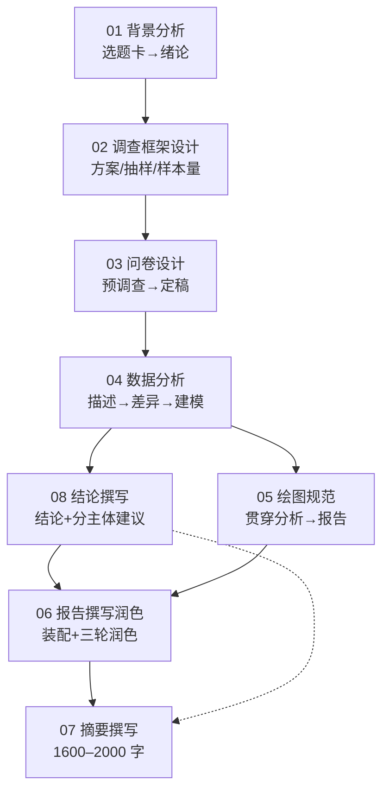

# 结构化市场调研 · Skill 体系（v0.3 · 8 个标准 skill 目录）

> 把「正大杯市场调查报告」从选题到定稿拆成 **8 个标准 skill**。每个 skill 都是一个独立目录，含三件套：
>
> - **`SKILL.md`** — 指令本体（front-matter 元数据 + 步骤/模板/验收/写法要点十段式）
> - **`examples/`** — 演示性质的示范文件（数据为演示用途，非参赛原文）
> - **`references/`** — 参考资料清单（赛制规则 + 方法论参考 + 开源工具）
>
> **依据**：大赛评分方式与评审标准 + 历届获奖作品写法的共性提炼（不在 skill 中陈列具体作品）+ 本仓库 `references/` 备赛资料。

---

## 一、目录总览

```
skills/
├── README.md                 # 本索引
├── OPEN_SOURCE_STACK.md      # 开源工具链总纲
├── survey-background-analysis/      01 背景分析
├── survey-framework-design/         02 调查框架设计
├── survey-questionnaire-design/     03 问卷设计
├── survey-data-analysis/            04 数据分析
├── survey-chart-visualization/      05 绘图规范
├── survey-report-writing/           06 报告撰写润色
├── survey-abstract-writing/         07 摘要撰写
└── survey-conclusion-writing/       08 结论撰写
```

## 二、技能总表

| # | Skill（目录 / 中文名） | 工序 | 对标评分 | 输入 → 输出 | 依赖 |
|---|---|---|---|---|---|
| 01 | [survey-background-analysis](survey-background-analysis/SKILL.md) · 背景分析 | 立项 | 研究选题 10 + 文献研究 7 | 选题卡 + 政策 + 文献 → 绪论（背景/意义/目的/创新点） | — |
| 02 | [survey-framework-design](survey-framework-design/SKILL.md) · 调查框架设计 | 方案 | 方案设计 20 | 研究点 + 假设 → 方案书 + 抽样方案 + 样本量 | 01 |
| 03 | [survey-questionnaire-design](survey-questionnaire-design/SKILL.md) · 问卷设计 | 实施 | 方案设计 20 + 调查实施 20 | 变量清单 → 问卷终稿 + 信效度报告 | 02 |
| 04 | [survey-data-analysis](survey-data-analysis/SKILL.md) · 数据分析 | 分析 | 分析与结论 25 | 回收数据 → 发现 + 结论证据链 | 03 |
| 05 | [survey-chart-visualization](survey-chart-visualization/SKILL.md) · 绘图规范 | 贯穿 | 报告文本 15 + 分析 25 | 分析结果 → 规范图表（300dpi/来源注/统一色板） | 04 |
| 06 | [survey-report-writing](survey-report-writing/SKILL.md) · 报告撰写润色 | 产出 | 报告文本 15 | 全流程素材 → 当届页数内参赛报告 | 04、05、08 |
| 07 | [survey-abstract-writing](survey-abstract-writing/SKILL.md) · 摘要撰写 | 产出 | 报告文本 15 | 全文 + 结论 → 1600–2000 字摘要 + 关键词 | 06、08 |
| 08 | [survey-conclusion-writing](survey-conclusion-writing/SKILL.md) · 结论撰写 | 产出 | 分析与结论 25 | 发现 + 映射表 → 结论 + 分主体建议 | 04 |

## 三、推荐执行顺序



> **先写结论（08）再写摘要（07）**：摘要要概括结论；结论要回指图表（04/05）。报告（06）在结论定稿后成篇，最后补摘要。

## 四、与评分表的映射

| 评分项 | 分值 | 主责 skill | 支撑 |
|---|---:|---|---|
| 研究选题 | 10 | 01 | — |
| 文献研究 | 7 | 01 | 04（方法可溯源） |
| 方案设计 | 20 | 02、03 | 01（研究点） |
| 调查实施 | 20 | 02、03 | 04（清洗与抽检） |
| 分析与结论 | 25 | 04、08 | 05（图表证据） |
| 报告文本 | 15 | 06、07 | 05 |
| 研究创新 | 3 | 01（创新点）+ 04（方法亮点） | 全流程 |

## 五、每个 skill 目录的组成约定

| 文件 | 内容 | 要求 |
|---|---|---|
| `SKILL.md` | front-matter（`name` + `title` + `description` + `layer` + `rubric` + `depends_on` + `feeds`）+ 十段式正文 | `description` 用"用于……"句式，供加载时识别触发 |
| `examples/` | 演示性质的示范文件（数据为演示用途，非参赛原文） | 每个 examples 文件开头注明对照 SK 的哪几步 |
| `references/` | `参考资料.md`：赛制与规则依据、方法论参考、数据渠道、开源工具 | 只引用规则与方法；不陈列具体作品 |

**SKILL.md 十段式**：定位与适用场景 → 输入清单 → 标准步骤 → 方法与模板 → 产出模板 → 验收标准 → 报告呈现要求 → 常见坑 → 开源工具链 → 写法要点（图表/摘要/结论类按需合并段落）。

## 六、与仓库现有资产的关系

| 仓库资产 | 服务于 |
|---|---|
| 2000 题选题库（`_industry_map.json` + 21 个行业目录） | 01 背景分析的选题卡输入 |
| `references/获奖名单/`（9555 条） | 01 选题避重核验 |
| `references/竞赛方式计分及报告评审说明.md` | 全部 skill 的验收标准 |
| `references/第十七届赛制资料/` | 时间线与赛制校准 |

## 七、通用红线（所有 skill 适用）

- **篇幅**：正文 ≤65 页，超页系统拒收；正文与附录分开提交；附录须含问卷与代码脚本。
- **证据分级**：沿用仓库惯例——✅ 官方/权威来源可直接引用；🔶 行业报告线索须核原文。
- **获奖避重**：选题须对照近三年获奖名单（研究对象可近、研究点不可重）。

## 八、使用方式

1. **人工使用**：按第三节顺序打开对应 skill 目录，先读 `SKILL.md`，再对照 `examples/` 仿写，最后用验收清单自检；需要出处时查 `references/`。
2. **AI 辅助**：将对应 `SKILL.md` 作为上下文交给 AI，让它按"步骤-验收"逐条核对；核心内容（方案/问卷/分析/结论）仍须团队产出。
3. **DSH 加载（可选）**：每个 skill 目录已符合 skill 包格式（`SKILL.md` + 资源目录），可直接复制到 DSH 的 skills 目录注册，由 AI 在会话中按 `name` 加载执行。
4. **开源工具链**：跨 skill 的安装命令、可复现代码（PPS/样本量/信效度/SEM/中介/LDA/IPA/GM(1,1)）、无 SPSS 的 GUI 替代（jamovi/JASP/PSPP）与许可说明，见 [OPEN_SOURCE_STACK.md](OPEN_SOURCE_STACK.md)。

## 九、变更记录

| 版本 | 日期 | 说明 |
|---|---|---|
| v1.0 | 2026-11-02 | 收尾完善：结构自检通过（代码围栏、表格列数、示例脚本语法）；执行顺序改为 Mermaid 流程图 |
| v0.9 | 2026-11-02 | 摘要字数口径调整：目标改为 1600–2000 字（不再取 1000–1500 常规区间），同步更新 SK7 五要素分配、验收、references、examples、SK6 页数预算与 README |
| v0.8 | 2026-11-02 | 摘要字数口径调整：中文摘要上限改为 2000 字（常规 1000–1500），同步更新五要素字数分配、结构自查表、验收项、SK6 页数预算与 examples 说明 |
| v0.7 | 2026-11-02 | 一致性审查修复：开源工具链章节统一编号（去掉版本戳）；references 相对路径由 `../../` 修正为 `../../../`；SK6 调查实施映射由 SK3/SK7 改为 SK2/SK3；SK6↔SK8 依赖关系解开环（SK6 依赖结论、SK8 仅喂报告）；SK6 标题与页数口径改为"当届为准"；README 十段式补入开源工具链 |
| v0.6 | 2026-11-02 | 按用户要求删除各 skill 文末的提示章节，并清空 skill 内全部 AI 合规表述（README 红线、reference 的 AI 规范行、附录 AI 说明项、正文 AI 措辞） |
| v0.5 | 2026-11-02 | 按用户要求：skill 内不再显示/陈列任何具体优秀作品（移除作品名称、文件路径、章节引用与来源标注）；"证据与范本"章节统一改为"写法要点（对照历届获奖作品自检）"；examples 标注为演示数据；references 改为规则/方法论/工具清单 |
| v0.4 | 2026-11-02 | 审计修订 + 开源工具链集成：新增 `OPEN_SOURCE_STACK.md`，每个 SKILL 增"开源工具链"，补充 RDS 抽样、弹性网络、CATPCA、随机森林、deff、EFA+CFA、AHP+模糊、IPA、试吃实验、灰色关联等方法卡；修复 SK5 代码兼容性、SK7 字数口径、SK6 页数预算、赛制时效表述 |
| v0.3 | 2026-11-02 | 8 个 skill 重构为标准目录（`SKILL.md` + `examples/` + `references/`），补齐 description 元数据、实例与参考资料 |
| v0.2 | 2026-11-02 | 按用户指定拆分为 8 个 skill（背景分析/调查框架设计/问卷设计/数据分析/绘图/报告撰写润色/摘要撰写/结论撰写） |
| v0.1 | 2026-11-02 | 14 个 skill 草案（SK01–SK14 分层方案，已被 v0.2 取代） |

---

© 呆塔大师兄（微信：a237658765）· 按行业分类选题库配套方法论